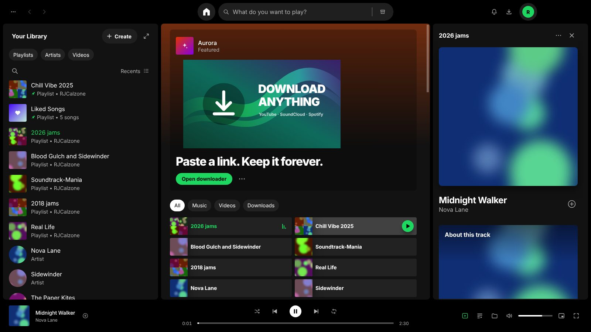
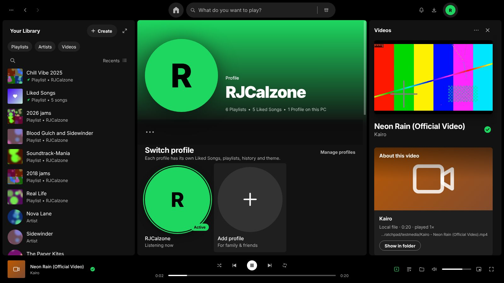
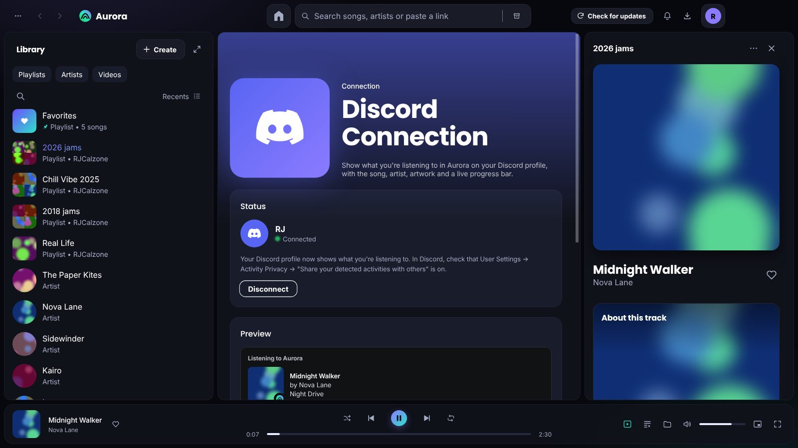
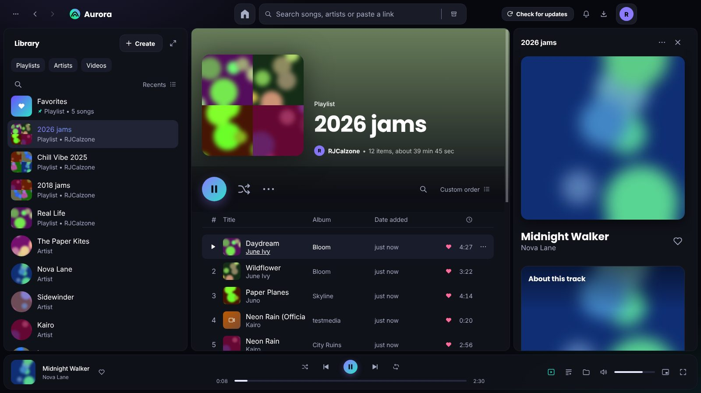

<p align="center"></p>
<h1 align="center">Aurora</h1>
<p align="center">A desktop music &amp; video player for Windows, with switchable profiles and a built-in Video Downloader.</p>



## Install

1. Download **`Aurora-Setup-<version>.exe`** from the [Releases](../../releases) page.
2. Double-click it and click **Next → Install → Finish**. No administrator rights are needed.
3. Aurora appears on your Desktop and in the Start menu.

Windows SmartScreen may warn that the app is from an unknown publisher because the installer isn't code-signed. Click **More info → Run anyway**.

Updating works the same way: run the newer installer. Your profiles, playlists and downloads are kept (they live in `%APPDATA%\Aurora`).

## Features

| | |
|---|---|
| **Three-panel layout** | Library on the left, Home/playlists in the middle, Now Playing on the right, player bar at the bottom. The panels can be resized and collapsed. |
| **Profiles** | Click your avatar (top right) → **Switch profile**, or open the **Profile** tab. Each profile has its own Favorites, playlists, history, accent colour and layout. You can turn on *Ask "Who's listening?" on startup*. |
| **Video Downloader** | Paste a link from YouTube, YouTube Music, SoundCloud, Vimeo, TikTok, Instagram, X, Twitch, Bandcamp and [1000+ other sites](https://github.com/yt-dlp/yt-dlp/blob/master/supportedsites.md). You can save it as MP4 (Best/1080p/720p), MP3 or M4A, and download whole playlists. Downloads go straight into your library. |
| **Spotify links** | Spotify audio is DRM-protected, so Aurora reads the track names from a Spotify track, album or playlist link and downloads the best matching public upload from YouTube. |
| **Plays everything** | MP3, M4A, FLAC, WAV, OGG, Opus, MP4, WebM and MKV. Videos play in the Now Playing panel, in full screen (F11) or in a pop-out picture-in-picture window. |
| **Library** | Favorites, playlists with custom covers, artist pages, search, sorting, a queue, shuffle and repeat. You can drag files or folders onto the window to import them. |
| **Discover** | Search YouTube or SoundCloud from Home, preview a video inside Aurora, then download it as MP4 or MP3. |
| **Friends** | Share your friend code, add friends, and see what they're listening to live. No account needed. |
| **Listen Together** | Host a session, share the code, and everyone hears the same song at the same second, with chat and reactions. Missing songs are fetched automatically. |
| **Your profile** | Bio, pronouns, status, banner, profile effects, and your favorite song, album and artist. |
| **Aurora Store** | 15 themes, 10 fonts, profile effects, player bar effects and one-click bundles. You can export and import themes as files. |
| **Discord Connection** | Shows what you're listening to on your Discord profile, with artwork, a progress bar and a link to the source. Turn it on from the avatar menu → Discord Connection, with the Discord desktop app open. |
| **Make it yours** | Settings → Appearance lets you pick an accent colour and write custom CSS. For deeper changes, edit `user.css` / `user.js` in the custom folder, or change the source (see below). |

| Profile | Discord Connection | Playlist |
|---|---|---|
|  |  |  |

### Keyboard shortcuts
`Space` play/pause · `Ctrl+→/←` next/previous · `Ctrl+↑/↓` volume · `Ctrl+S` shuffle · `Ctrl+R` repeat · `Ctrl+K` search · `Ctrl+N` new playlist · `Ctrl+D` downloader · `Alt+←/→` back/forward · `F11` full screen

## Modifying Aurora

Aurora is plain HTML/CSS/JavaScript on [Electron](https://www.electronjs.org/). There is no framework and no build step for the UI.

```
src/
  main/main.js         window, IPC, file dialogs           (Node side)
  main/downloader.js   Video Downloader engine (yt-dlp + ffmpeg)
  main/media.js        folder scanning, ID3 tags
  main/store.js        JSON storage in %APPDATA%\Aurora\data
  preload.js           safe bridge exposed to the UI as window.native
  renderer/
    index.html         app shell
    css/app.css        the whole theme (colours are CSS variables at the top)
    js/state.js        profiles, tracks, playlists, likes
    js/player.js       playback engine
    js/ui.js           cards, track lists, menus, modals
    js/app.js          routing, sidebar, right panel, player bar
    js/views/*.js      Home, Search, Playlist, Profile, Video Downloader, Settings
scripts/build-win.sh   builds dist/Aurora-Setup-<version>.exe
build/installer.nsi    the installer (NSIS)
```

**Run from source:** install [Node.js](https://nodejs.org), then run `npm install` and `npm start`.

**Build the installer:** run `bash scripts/build-win.sh` from Git Bash, WSL, Linux or macOS. It downloads Electron, yt-dlp and NSIS from GitHub and writes `dist/Aurora-Setup-<version>.exe`. Pushing a tag such as `v1.0.1` also builds it on GitHub Actions and attaches it to a Release.

## Version history and rollback

Every change is a separate git commit, and every release is tagged (`v1.0.0`, `v1.0.1`, …). To go back:

- **Use an older build:** download an older installer from [Releases](../../releases) and run it.
- **Roll the code back:** `git log --oneline` lists the versions. Use `git checkout v1.0.0` to look at an old version, or `git revert <commit>` to undo a change while keeping the history.

See [CHANGELOG.md](CHANGELOG.md) for what changed in each version.

## Legal

Aurora is an independent project. It is not affiliated with Spotify, YouTube or any other service. Only download content you own or have permission to save, and follow each site's terms of service and your local copyright law.

Third-party components: Electron (MIT), yt-dlp (Unlicense), FFmpeg (LGPL/GPL, downloaded on first use), Inter typeface (SIL OFL 1.1). Aurora's own code is MIT-licensed.
